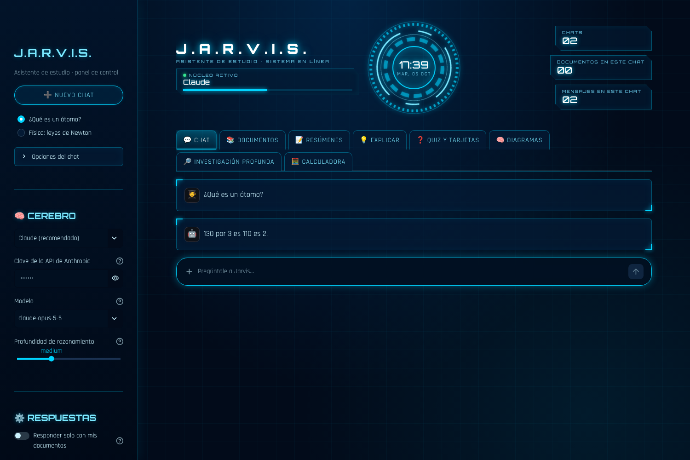

# J.A.R.V.I.S. · Asistente de estudio + modelo de IA propio



Este proyecto tiene dos partes:

1. **La app de estudio** (`app.py`): sube PDFs y apuntes, conversa con ellos, resuelve problemas de matemáticas, física y química paso a paso, crea resúmenes, quizzes, tarjetas, mapas mentales, diagramas y presentaciones de PowerPoint, y hace investigaciones profundas con búsqueda en internet.
2. **Tu propio modelo de lenguaje desde cero** (`jarvis/`, `train.py`, `finetune.py`): un GPT pequeño construido pieza a pieza siguiendo la sección [Build your own AI Model](https://github.com/codecrafters-io/build-your-own-x#build-your-own-ai-model) de *build-your-own-x*.

## Instalación

```bash
python -m venv .venv
source .venv/bin/activate        # en Windows: .venv\Scripts\activate
pip install -r requirements.txt
```

---

## Parte 1 · La app de estudio

```bash
streamlit run app.py
```

Se abre en el navegador (http://localhost:8501).

### Elige el "cerebro"

En la barra lateral eliges qué modelo genera las respuestas. El resto de la app (PDFs, buscador, cálculo exacto, diagramas, chats) es código propio y funciona con cualquiera de ellos.

| Motor | Para qué sirve | Coste |
|---|---|---|
| **Claude** (recomendado) | El más capaz. Resuelve problemas, usa las herramientas de cálculo de forma automática, ve fotos de ejercicios y **busca y lee páginas web**. | De pago por uso. Necesitas una clave de API de [platform.claude.com](https://platform.claude.com/). |
| **Ollama** | Modelos abiertos que se ejecutan en tu ordenador, sin internet. Instala [Ollama](https://ollama.com) y ejecuta `ollama pull llama3.1` (o `qwen2.5`, `gemma2`…). | Gratis. Necesita un ordenador potente. |
| **Jarvis (modelo propio)** | El modelo que entrenas en la parte 2. Es educativo: con unos pocos millones de parámetros escribe frases sencillas, pero no puede resolver tareas reales. | Gratis. |

La clave de Claude se puede escribir en la barra lateral o definir antes de arrancar: `export ANTHROPIC_API_KEY=...`.

> **Privacidad:** con Claude, el texto de tus preguntas y los fragmentos de tus documentos se envían a la API de Anthropic. Con Ollama o con el modelo propio, todo se queda en tu ordenador.

### Qué puede hacer

| Pestaña | Funciones |
|---|---|
| 💬 **Chat** | Varios chats guardados (nuevo, renombrar, borrar). Adjunta PDFs o **fotos de ejercicios** con el clip. Opciones: *Responder solo con mis documentos* (respuestas solo según tus textos, citando [n] y la página) y *Buscar en internet*. En cada respuesta se pueden ver las fuentes web, los fragmentos de tus documentos y los cálculos usados. |
| 📚 **Documentos** | Sube PDF, Word, TXT, Markdown o HTML, o importa una página web o un PDF en línea por URL. Cada chat tiene sus propios documentos. |
| 📝 **Resúmenes** | 10 formatos: breve, detallado, puntos clave, esquema jerárquico, método Cornell, tabla comparativa, glosario, hoja de fórmulas, línea de tiempo y explicación para niños. Los documentos largos se resumen por partes. Descarga en Markdown o Word. |
| 💡 **Explicar** | Explica un concepto en 4 niveles (niño, secundaria, universidad, experto) con analogía, ejemplo resuelto, errores comunes y preguntas para comprobar que lo entendiste. |
| ❓ **Quiz y tarjetas** | Quizzes interactivos (opción múltiple, verdadero/falso, respuesta corta corregida por la IA) con nota y explicaciones. Tarjetas de estudio que se giran, exportables a Anki o Quizlet (CSV). |
| 🧠 **Diagramas** | Mapas mentales, diagramas de flujo, mapas conceptuales, ciclos y jerarquías (descarga en HTML o Graphviz), y **presentaciones de PowerPoint (.pptx)** con notas del orador. |
| 🔎 **Investigación profunda** | Divide tu pregunta en subpreguntas, investiga cada una en internet y en tus documentos, contrasta las fuentes y redacta un informe con referencias. |
| 🧮 **Calculadora** | Cálculo exacto sin IA: ecuaciones y sistemas, derivadas, integrales, límites, series, matrices, masa molar y ajuste de reacciones químicas. |

### Cómo funciona por dentro

| Archivo | Qué hace |
|---|---|
| `asistente/documentos.py` | Lee PDF (pypdf), Word, HTML y texto; descarga páginas web; divide el texto en fragmentos con solape. |
| `asistente/busqueda.py` | Buscador **BM25 escrito desde cero**: es la "R" de RAG (*Retrieval-Augmented Generation*, la tercera guía de *build-your-own-x*). Antes de responder, Jarvis busca los fragmentos más relevantes y se los da al modelo. |
| `asistente/ciencia.py` | Matemáticas exactas con SymPy y química (masas molares, ajuste de ecuaciones por álgebra lineal). |
| `asistente/herramientas.py` | Expone esas funciones como herramientas que Claude puede llamar mientras razona, para no equivocarse en las cuentas. |
| `asistente/motores.py` | Los tres motores con la misma interfaz. Claude usa razonamiento adaptativo, herramientas, búsqueda web y salidas JSON validadas con un esquema. |
| `asistente/estudio.py` | Las funciones de estudio y sus instrucciones (*prompts*). |
| `asistente/exportar.py` | Exporta a Word, PowerPoint, Graphviz, Mermaid y CSV. |
| `asistente/almacen.py` | Guarda chats, mensajes y documentos en SQLite (`jarvis_datos/jarvis.db`). |
| `asistente/tema.py` | El diseño HUD futurista de la interfaz. |

Limitaciones: los PDFs escaneados (solo imagen) no tienen texto que leer; pásalos antes por un programa de OCR. La página HTML de los diagramas necesita internet para dibujarse.

---

## Parte 2 · Tu propio modelo desde cero

Sigue el tutorial [**LLMs-from-scratch**](https://github.com/rasbt/LLMs-from-scratch) de Sebastian Raschka:

| Capítulo del tutorial | Archivo | Qué hace |
|---|---|---|
| 2. Trabajar con texto | `jarvis/tokenizer.py` | Tokenizador BPE propio, entrenado con tus textos (funciona bien en español) |
| 2. Trabajar con texto | `jarvis/data.py` | Ventana deslizante: entrada → siguiente token |
| 3. Mecanismo de atención | `jarvis/model.py` | `MultiHeadAttention` con máscara causal |
| 4. Implementar GPT | `jarvis/model.py` | `LayerNorm`, `GELU`, `FeedForward`, `TransformerBlock`, `GPTModel` |
| 5. Preentrenamiento | `train.py` | Bucle de entrenamiento con pérdida de entrenamiento y validación |
| 5. Generar texto | `jarvis/generate.py`, `chat.py` | Muestreo con `temperature` y `top_k` |
| 7. Ajuste fino con instrucciones | `jarvis/instruct.py`, `finetune.py` | Enseña al modelo a seguir instrucciones (plantilla estilo Alpaca) |

### 1. Preentrenar (aprender el idioma)

```bash
python scripts/download_data.py      # descarga Don Quijote (dominio público) a data/
python train.py --epochs 3           # en CPU puede tardar horas; con GPU, mucho menos
```

El entrenamiento usa todos los `.txt` de `data/`: añade tus propios textos para que aprenda más. Para una prueba rápida con el texto de ejemplo:

```bash
python train.py --vocab-size 512 --batch-size 8 --epochs 30 --eval-every 50
```

### 2. Ajuste fino (aprender a seguir instrucciones)

```bash
python finetune.py                   # usa data/instrucciones/*.jsonl
```

Cada línea de `data/instrucciones/jarvis_basico.jsonl` es un ejemplo:

```json
{"instruction": "¿Qué es la fotosíntesis?", "input": "", "output": "La fotosíntesis es..."}
```

Añade más archivos `.jsonl` a esa carpeta: con cientos o miles de ejemplos, el modelo responde mucho mejor.

### 3. Hablar con tu modelo

```bash
python chat.py --model checkpoints/jarvis-chat --instruct
```

También puedes elegir **Jarvis (modelo propio)** en la barra lateral de la app.

### Cómo leer la salida del entrenamiento

- **pérdida train / val**: cuánto se equivoca el modelo. Debe bajar.
- **perplejidad**: aproximadamente, entre cuántos tokens "duda" el modelo. Cuanto más baja, mejor.
- Si la pérdida de *train* baja pero la de *val* sube, el modelo está **memorizando** (sobreajuste): añade más texto, sube `--dropout` o entrena menos épocas. El modelo se guarda automáticamente en el punto con mejor pérdida de validación.

### Opciones de `train.py`

| Opción | Por defecto | Descripción |
|---|---|---|
| `--data` | `data` | Archivo `.txt` o carpeta con archivos `.txt` |
| `--out` | `checkpoints/jarvis` | Dónde se guarda el modelo |
| `--vocab-size` | 2048 | Tamaño del vocabulario del tokenizador |
| `--context-length` | 128 | Tokens que el modelo ve a la vez |
| `--emb-dim` / `--layers` / `--heads` | 256 / 4 / 4 | Tamaño del modelo (`emb-dim` debe ser divisible por `heads`) |
| `--epochs` / `--max-steps` | 10 / — | Duración del entrenamiento |
| `--lr` | 4e-4 | Tasa de aprendizaje |

---

## Pruebas

```bash
python -m pytest
```
